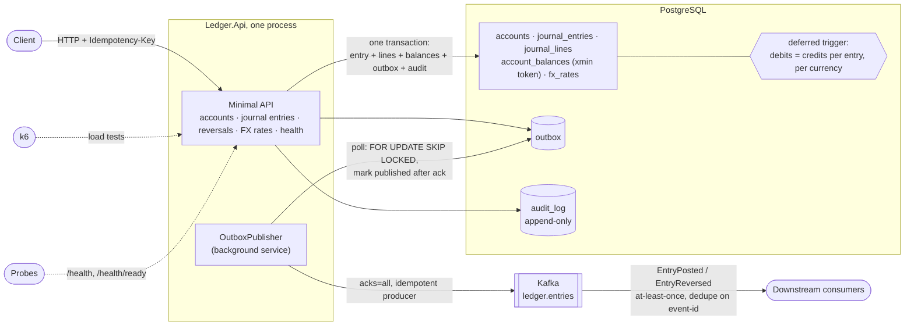
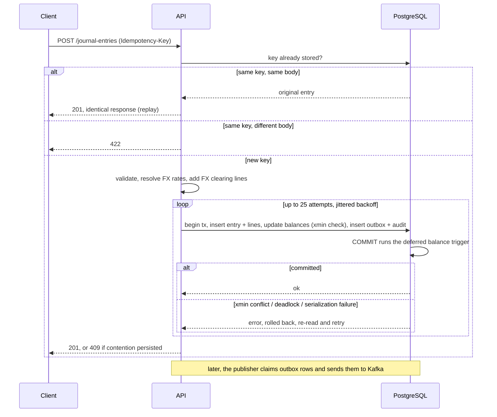

# Double-Entry Ledger Service

A backend service that records money movements as balanced journal entries. Every transaction is stored as a set of debit and credit lines that must balance, so the books cannot drift out of balance. The service supports multiple currencies, is safe to retry, and publishes events for downstream systems.

The central design principle: **the database enforces correctness, not just the application code.**

**Stack:** .NET 10, PostgreSQL, Kafka, k6, Docker Compose.

## Table of Contents

- [Features](#features)
- [Architecture](#architecture)
- [Domain Model](#domain-model)
- [Invariants and How They Are Enforced](#invariants-and-how-they-are-enforced)
- [Design Decisions](#design-decisions)
- [API](#api)
- [Getting Started](#getting-started)
- [Testing](#testing)
- [Load Testing](#load-testing)
- [Out of Scope](#out-of-scope)
- [Roadmap](#roadmap)

## Features

- Accounts and immutable journal entries with a database-enforced rule that debits equal credits
- Idempotency keys for safe client retries
- Optimistic concurrency on accounts and balances
- Exact `decimal` money handling with a documented rounding policy
- Multi-currency support with saved FX rates, so historical entries stay reproducible
- Transactional outbox that publishes events to Kafka
- Append-only audit trail
- k6 load tests with published p99 latency and throughput

## Architecture



**One posting, step by step** (`POST /journal-entries`, `POST /journal-entries/{id}/reverse` shares the write path):



The three layers that keep the books correct are in the database, not the application: the balance trigger, the unique indexes (idempotency key, one reversal per entry) and the audit log's triggers and revoked privileges. See [Invariants](#invariants-and-how-they-are-enforced).

## Domain Model

| Entity | Description |
|---|---|
| **Account** | Id, code, type (asset, liability, equity, revenue, expense), currency, status |
| **Journal entry** | Immutable header: id, idempotency key, posted-at, description, reference |
| **Journal line** | Entry id, account id, direction (debit or credit), amount, currency, and for FX lines the rate used |
| **Account balance** | Maintained projection derived from lines, for fast reads |
| **FX rate** | Base, quote, rate, effective-at, source |

**Corrections are never edits or deletes.** To fix a mistake, post a reversing entry.

## Invariants and How They Are Enforced

| Invariant | Enforcement | Verified by |
|---|---|---|
| Debits equal credits per entry | Deferred constraint trigger on `journal_lines`, checked at commit | SQL-level test that inserts an unbalanced entry directly and expects failure |
| A retried request never posts twice | `Idempotency-Key` header, unique index, stored request hash. Replay returns the original response. Same key with a different body returns 409/422 | Concurrent duplicate-request test produces exactly one entry |
| No lost updates on balances | Version column (or `xmin`) as concurrency token, with retry on conflict | Hot-account contention test |
| No floating-point money | `numeric(19,4)` columns, `decimal` in C#, explicit rounding rules | Property-based tests |
| FX history is reproducible | Each line stores original amount, rate, and converted amount | Test that changes rates and re-reads old entries |
| Events are never lost | Outbox row written in the same transaction as the entry | Kill-the-publisher test: no events lost on restart |
| Audit history cannot be altered | UPDATE/DELETE revoked and blocked by triggers, optional hash chain | Tamper-attempt demo |

## Audit Trail

Every mutation writes an `AuditLog` row in the same transaction as the change: `account.created` (including auto-created FX clearing accounts, flagged `system`), `fx_rate.recorded`, `entry.posted` and `entry.reversed` (entry id, idempotency key, `reversesEntryId`, account ids). Failed, rejected and replayed requests write nothing.

The log is append-only at two layers: a row trigger blocks `UPDATE`/`DELETE`, a statement trigger blocks `TRUNCATE`, and the service role `ledger_app` has those privileges revoked (`db/init.sql` creates the role; the `AuditHardening` migration grants it everything else). Run migrations as the owner and the service as `ledger_app`; the Development setup uses the owner for convenience. `AuditTamperTests` is the tamper-attempt demo.

**Known ceiling:** the table owner or a superuser can still drop the triggers. A hash chain would detect that, but chaining rows serializes every audited write (each row needs the previous hash), so it is not implemented. Add it, or ship the log to external write-once storage, if that threat matters.

## Design Decisions

1. **Balancing across currencies.** A line may be expressed in a currency other than its account's (`currency` on the line). The client balances the entry in the currencies it wrote; the service converts using the latest rate (direct, else the inverse of the opposite pair), stores original amount, original currency and the rate used on the line, and plugs each booked currency's remaining imbalance with an auto-created `FX-CLEARING-<CCY>` equity account. The database trigger then verifies every booked currency balances. Rates are append-only; conversions use the rate in force at posting time.
2. **Balance reads.** A maintained `account_balances` projection is updated in the same transaction as the entry. This is what motivates optimistic concurrency.
3. **Isolation level.** Read Committed plus constraints and version checks. Balance rows carry an `xmin` concurrency token, so a concurrent writer fails the `UPDATE` instead of overwriting; the whole posting is then retried (up to 25 attempts, jittered backoff) and re-reads fresh balances. Deadlocks and serialization failures are retried the same way. Exhausted retries return 409. Optimistic concurrency trades throughput on a single hot account for no row locks on the read path; the contention load test measures that cost.
4. **Event delivery.** At-least-once via the outbox. The outbox row is written in the same transaction as the entry. The publisher claims rows with `FOR UPDATE SKIP LOCKED`, hands a batch of 500 to the producer at once (`acks=all`, idempotent), reads the acknowledgements in order, and marks only the unbroken run of successes as published in the same transaction. A failure or crash re-sends everything from the first unacknowledged event on, so there can be duplicates but never gaps. Consumers deduplicate on event id. With several publishers, rows are never sent twice concurrently but global order is not preserved; run one publisher if you need `CreatedAt` order.
5. **Event contract.** Two types, `EntryPosted` and `EntryReversed`, on topic `ledger.entries` (`Kafka:Topic`), keyed by entry id (ordering is per entry only). Kafka headers carry `event-id` and `event-type`. Value is JSON, version 1; changes are additive, breaking changes bump `version`:

   ```json
   {
     "eventId": "7e07cc87-…", "type": "EntryPosted", "version": 1,
     "occurredAt": "2026-10-23T07:40:13.255490+00:00",
     "entryId": "930f03b7-…", "reversesEntryId": null,
     "description": "smoke", "reference": null,
     "lines": [{ "id": "…", "accountId": "…", "direction": "Debit", "amount": 12.5000, "currency": "USD",
                 "originalAmount": null, "originalCurrency": null, "fxRate": null }]
   }
   ```

   `lines` includes FX clearing lines, so a consumer sees exactly what was booked. The payload is built from the same DTO the API returns. `EntryReversed` sets `reversesEntryId`.
6. **Rounding policy.** Scale is 4 decimal places (`numeric(19,4)`). Client amounts are never rounded: more than 4 decimals is rejected with 422. Computed amounts (FX conversion, phase 5) use `MidpointRounding.ToEven`.

## API

| Method | Path | Notes |
|---|---|---|
| POST | `/accounts` | Create an account |
| GET | `/accounts/{id}` | Fetch an account |
| POST | `/journal-entries` | Post an entry. Requires `Idempotency-Key` |
| POST | `/journal-entries/{id}/reverse` | Post a reversing entry. Requires `Idempotency-Key`; optional `description`/`reference`. 409 if already reversed |
| GET | `/accounts/{id}/balance` | Current balance |
| GET | `/accounts/{id}/transactions` | Transaction history |
| POST | `/fx-rates` | Record an FX rate |

## Getting Started

**Prerequisites:** Docker, .NET 10 SDK, k6 (for load tests).

```bash
# Everything in containers: Postgres, Kafka, and the API on http://localhost:8080
docker compose up --build

# Or run the API locally against containerized dependencies (Development settings, migrates on startup)
docker compose up -d postgres kafka
dotnet run --project src/Ledger.Api
```

- The API container connects to Postgres as the unprivileged `ledger_app` role and runs migrations with the owner connection (`ConnectionStrings:Migrations`). `db/init.sql` creates the role only on a **fresh** Postgres volume; on an existing volume run its `CREATE ROLE` once by hand (or `docker compose down -v` to start over).
- Add a migration: `dotnet ef migrations add <Name> -p src/Ledger.Api -o Data/Migrations` (the tool is pinned in `dotnet-tools.json`; run `dotnet tool restore` first).

### Development tools

Both are for local development and are **off everywhere else**.

| Tool | How to start | URL |
|---|---|---|
| Swagger UI + OpenAPI document | Run in the `Development` environment: `dotnet run --project src/Ledger.Api` (the launch profile and `appsettings.Development.json` do this), or `ASPNETCORE_ENVIRONMENT=Development docker compose up` | `/swagger` and `/openapi/v1.json` on the API's port (`http://localhost:5174` with `dotnet run`, `http://localhost:8080` in Docker) |
| Kafka UI ([kafbat](https://github.com/kafbat/kafka-ui)) | `docker compose --profile dev up -d` | http://localhost:8081 |

- **Swagger** is registered only when the environment is `Development`; in any other environment (including the default Docker one, which is `Production`) the routes do not exist and return 404. `DevToolsTests` checks Development, Production, Staging and Testing. The document lists the real responses (201 and the problem+json errors) and marks `Idempotency-Key` as required.
- **Kafka UI** is behind a compose profile, so a plain `docker compose up` does not start it. It listens on `127.0.0.1` only, is **read-only** (set `KAFKA_CLUSTERS_0_READONLY` to `"false"` in `docker-compose.yml` to create topics or produce messages), and cannot add clusters from the UI. Look for the `ledger.entries` topic.
- Neither tool has authentication, which is why they must not run in a shared or production environment.

### Operations

| Endpoint | Meaning |
|---|---|
| `GET /health` | Liveness: the process is up |
| `GET /health/ready` | Readiness: Postgres reachable (and Kafka, when configured). 503 otherwise |

- **Errors** are RFC 9457 `application/problem+json`: 400 missing header or malformed body, 404, 409 conflict (duplicate code, already reversed, contention retries exhausted), 422 validation, 500 unhandled (no internals leaked).
- **Correlation:** send `X-Correlation-Id` or one is generated; it is echoed on every response, including errors, and attached to every log line of the request.
- **Logs** are one JSON object per line outside local development.

## Testing

```bash
dotnet test
```

- **SQL-level tests:** the balance trigger, audit-table protections
- **Integration tests:** idempotency, concurrency, outbox, against a real PostgreSQL instance
- **Property-based tests:** decimal arithmetic and rounding

## Load Testing

One k6 script, `loadtest/ledger.js`, three scenarios (`-e SCENARIO=...`). Each run creates its own fresh accounts in `setup()`, all USD, and every posting is a 2-line entry with an `Idempotency-Key`:

1. **steady**: writes only, spread over 200 accounts (little contention)
2. **contention**: writes only, every virtual user hitting the same 5 accounts
3. **mixed**: 20% postings, 80% reads (balance and history, page size 20) over 200 accounts

```bash
docker compose up -d --build
k6 run -e SCENARIO=steady -e BASE_URL=http://localhost:8080 loadtest/ledger.js   # or contention | mixed

# without installing k6 (attach to the compose network; use -p <project>_default for a named project)
docker run --rm --network <project>_default -v "$PWD/loadtest:/loadtest" -e BASE_URL=http://api:8080 \
  -e SCENARIO=steady grafana/k6 run --summary-export=/loadtest/results/steady.json /loadtest/ledger.js
```

Raw k6 summaries are in `loadtest/results/`.

### Results

32 virtual users, 60 s per scenario, closed loop (each user sends its next request as soon as the last one returns), so these are saturation numbers, not latency at a fixed arrival rate.

| Scenario | Throughput (entries/s) | p50 | p95 | p99 | max | Error / conflict rate |
|---|---|---|---|---|---|---|
| Steady-state (200 accounts) | 2,239 (a repeat run: 2,286) | 10.0 ms | 33.7 ms | 68.2 ms | 639 ms | 0% / 0% |
| Contention (5 accounts) | 652 | 8.8 ms | 245 ms | 800 ms | 3,027 ms | 0% / 0.003% (1 of 39,326 got 409) |
| Mixed, writes (20% of ops) | 1,307 | 8.8 ms | 20.2 ms | 34.3 ms | 323 ms | 0% / 0% |
| Mixed, reads (80% of ops) | 5,253 reads/s | 3.1 ms | 6.2 ms | 9.4 ms | 97 ms | 0% |

Latency is the client-side HTTP time for the posting (or read) request.

**Test conditions**
- Apple M1 Pro (10 cores, 16 GB). Docker Desktop with 10 CPUs and 8 GB. The API, PostgreSQL 17, Kafka and **k6 all ran on this one machine** (k6 from the `grafana/k6` image, v2.3.0), so they competed for the same cores; a separate load generator would likely do better.
- PostgreSQL: stock `postgres:17` image, default configuration (`shared_buffers` 128 MB, `fsync` and `synchronous_commit` on), data in a Docker volume. The API used the default Npgsql pool (100). Single-broker Kafka.
- Everything was on for every run: balance trigger, idempotency, optimistic concurrency with retries, outbox and audit writes, and the outbox publisher.
- Fresh stack, then one un-reported 10 s warm-up run. The database was **not** reset between scenarios, so each ran against what the previous ones left: about 15k entries at the start of steady, 152k at contention, 191k at mixed (408k at the end, after the steady repeat). Each scenario's own accounts were new, so per-account histories stayed short; deep-history reads were not tested.
- Correctness after all runs: 0 accounts whose stored balance differed from the sum of their lines, and 0 entries unbalanced in any currency.
- Outbox backlog after every scenario: 0 unpublished rows.

**What the numbers say**
- Steady-state is limited by a write path that does a transaction, two balance updates, an outbox row and an audit row per request, not by contention.
- Under contention the median is unchanged but the tail is not: retries with backoff cost p95 245 ms and p99 800 ms, and throughput is under a third of steady-state. Correctness held (no lost updates; 1 request in 39k exhausted its retries). If hot-account tails matter, serialize writers per account instead of retrying.
- **The outbox publisher keeps up at these rates.** A first version of these runs found it could not: it sent one message at a time and waited for each acknowledgement, which drained about 140 events/s against 2,000+ postings/s and left a backlog of about 260k unpublished rows. It now hands each batch of 500 to the producer at once and acknowledges in order, and the backlog stayed at 0 during and after every run. That first run also made steady-state look faster (2,661 entries/s vs about 2,240–2,290 now) because the publisher was mostly idle; the figures above include a publisher doing real work on the same machine. The publisher's own maximum rate was not measured, only that it exceeds ~2,300 events/s here.

## Out of Scope

- Authentication and multi-tenancy
- A user interface
- Reporting and period-close
- Regulatory compliance

## Roadmap

- [x] Schema, migrations, and balance-check trigger with SQL-level tests
- [x] Post and read entries with decimal handling
- [x] Idempotency
- [x] Optimistic concurrency
- [x] Multi-currency and FX
- [x] Outbox, publisher, and Kafka via Docker Compose
- [x] Append-only audit trail
- [x] k6 load tests and published results

## License

TBD